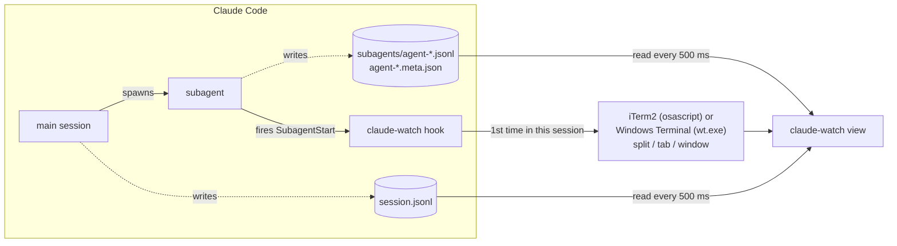

# claude-watch

A live terminal view of a Claude Code session: the main agent, every subagent
it spawns, what each one is doing right now, and how many tokens each has used.
It opens by itself beside Claude the moment a subagent starts.

```
                      ╔════════════════════════════════════════════════════╗
                      ║ main session                                       ║
                      ║ opus 5.5                                           ║
                      ║ ◐ Agent Find call sites                            ║
                      ║ 1.2M tok · ctx 157k                                ║
                      ║ 61 tools · 14m05s                                  ║
                      ╚════════════════════════════════════════════════════╝
                                                │
                               delegated to 2 subagents · 1 running
                                                ▼
                   ╭────────────────────────────╮ ╭────────────────────────────╮
                   │ Map the repo               │ │ Find call sites            │
                   │ Explore · haiku 5.5        │ │ general-purpose · sonnet 5.5│
                   │ ✓ done                     │ │ ◑ Grep login\(             │
                   │ 280k tok · ctx 51.7k       │ │ 31k tok · ctx 18.2k        │
                   │ 7 tools · 42s              │ │ 3 tools · 9s               │
                   ╰────────────────────────────╯ ╰────────────────────────────╯
┌──────────────────────────────────────────────────────────────────────────────┐
│ session log                                                                  │
│ 12:37:42 main             → Agent Find call sites                            │
│ 12:37:44 Find call sites  → Grep login\(                                     │
└──────────────────────────────────────────────────────────────────────────────┘
```

## Does it cost tokens?

**No.** claude-watch never calls Claude or any API. It only reads the log
files Claude Code already writes to your disk. The hook prints nothing, so it
adds nothing to Claude's context either. The token numbers it shows are read
from those logs, not spent by it.

## Setup

Requires Node 20+. The view runs in any terminal. Where it can open by itself:

| OS      | Claude running in…                         | `split` | `tab` | `window`               |
|---------|--------------------------------------------|:-------:|:-----:|------------------------|
| macOS   | iTerm2                                     | ✓       | ✓     | ✓ iTerm2 window        |
| macOS   | Terminal.app / other                       |         |       | ✓ Terminal.app window  |
| Windows | Windows Terminal (PowerShell or Git Bash)  | ✓       | ✓     | ✓ new console window   |
| Windows | plain PowerShell console, Git Bash (mintty)|         |       | ✓ new console window   |
| Linux   | any                                        |         |       | not yet: run it by hand |

Placements that don't fit are skipped, so the default order
(`split` → `tab` → `window`) works everywhere.

**macOS / Linux / Git Bash**

```sh
git clone https://github.com/<you>/claude-watch ~/.claude/claude-watch
cd ~/.claude/claude-watch
npm ci && npm run build
node dist/cli.js install-hook
```

**Windows PowerShell**

```powershell
git clone https://github.com/<you>/claude-watch "$HOME\.claude\claude-watch"
cd "$HOME\.claude\claude-watch"
npm ci; npm run build
node dist/cli.js install-hook
```

`install-hook` adds one `SubagentStart` hook to `~/.claude/settings.json`,
creates `config.json` from the example, and keeps a backup of your previous
settings at `~/.claude/settings.json.claude-watch.bak`. It leaves every other
setting and hook as it is, and running it twice does nothing the second time.
It reformats the settings file with 2-space indentation.

Then restart any open Claude Code sessions.

On macOS, the first time the hook opens a pane, macOS asks whether your
terminal may control iTerm2. Allow it, or no pane will open.

On Windows, `install-hook` writes the path with forward slashes
(`C:/Users/you/...`), which works whether Claude Code runs hooks through Git
Bash or PowerShell.

Other options:

```sh
node dist/cli.js install-hook --dry-run            # show what would change
node dist/cli.js install-hook --settings <path>    # e.g. a project's .claude/settings.json
node dist/cli.js uninstall-hook                    # remove the hook again
```

<details>
<summary>Prefer to edit settings by hand?</summary>

Add this to `~/.claude/settings.json`, using your own path:

```json
{
  "hooks": {
    "SubagentStart": [
      {
        "hooks": [
          { "type": "command", "command": "node \"/Users/you/.claude/claude-watch/dist/cli.js\" hook", "timeout": 15 }
        ]
      }
    ]
  }
}
```
</details>

## Use it by hand

You don't need the hook to use the view:

```sh
node ~/.claude/claude-watch/dist/cli.js                 # most recently active session
node ~/.claude/claude-watch/dist/cli.js <session-id>
node ~/.claude/claude-watch/dist/cli.js <path/to/session.jsonl>
```

Keys: `q` quits (and closes the pane when the hook opened it); `t` switches to
the full token ledger listing every agent.

### Token ledger

Below the agent boxes, a ledger keeps running token totals per agent:

| column     | meaning                                   |
|------------|-------------------------------------------|
| `in`       | fresh input tokens (not from cache)       |
| `cache rd` | input tokens read from the prompt cache   |
| `cache wr` | input tokens written to the prompt cache  |
| `out`      | output tokens the agent generated         |
| `total`    | all four added together                   |

The **total** row always covers the main session and *every* subagent,
including finished ones. To save space, boxes for older finished agents fold
into a "+N earlier finished" line, and the compact ledger sums them into a
"+N more" row. Press `t` to list every agent on its own line.

## How it works



**1. Claude Code already logs everything.** Every session is written to
`~/.claude/projects/<project>/<session-id>.jsonl`, one JSON object per line:
your prompts, each model reply (with its model name and token `usage`), every
tool call and every tool result. Each subagent gets its own log in
`<session-id>/subagents/agent-<id>.jsonl`, plus a small `agent-<id>.meta.json`
with its task description, type, model and whether it has finished.

**2. The hook decides when to open the view.** Claude Code runs
`claude-watch hook` whenever a subagent starts and passes it the session ID and
log path on stdin. The hook:

- counts the session's subagents that have not finished, using the
  `.meta.json` files;
- if that count reaches `minSubagents`, claims a once-per-session marker in
  `state/`. File creation is atomic, so two agents starting together can't
  open two views;
- opens the view, trying each `placement` in order:
  - **macOS**: AppleScript asks iTerm2 to split Claude's pane (found by
    `$ITERM_SESSION_ID`) or add a tab; otherwise it opens a new window.
  - **Windows**: inside Windows Terminal (`$WT_SESSION`), `wt.exe -w 0`
    splits the current window or adds a tab; otherwise `cmd /c start` opens a
    new console window.
- gives keyboard focus back to Claude, so your typing isn't interrupted.

It always exits 0 and prints nothing, so it can't block or change Claude. It
only opens anything when a person is using Claude in a terminal: it checks
Claude Code's `CLAUDE_CODE_SESSION_ATTENDED` / `CLAUDE_CODE_ENTRYPOINT`, so SDK
runs, `claude -p` scripts and CI never pop windows. Its decisions are logged to
`state/hook.log`.

**3. The view follows the logs.** Every 500 ms it reads only the bytes
appended since the last check, both from the main log and from each subagent's
log (new subagents are picked up as their files appear). From each line it
works out:

| shown           | where it comes from                                                       |
|-----------------|---------------------------------------------------------------------------|
| model           | `message.model` of the agent's replies                                    |
| current activity| the latest `tool_use` that has no `tool_result` yet, e.g. `Grep login(`   |
| status          | running; idle after a reply that ends the turn; done once `meta.finished` |
| tok             | sum of `usage` over all replies (input + cache read + cache write + output)|
| ctx             | prompt size of the latest reply, i.e. how full its context is             |
| tools / time    | number of tool calls; time from first to latest log line                  |

A single reply can be split over several log lines that repeat the same
`usage`. Each reply is counted once, by its message ID.

## Config

`~/.claude/claude-watch/config.json` (or the path in `$CLAUDE_WATCH_CONFIG`):

| key              | default                       | meaning                                                      |
|------------------|-------------------------------|--------------------------------------------------------------|
| `enabled`        | `true`                        | `false` stops the hook from opening anything                 |
| `placement`      | `["split", "tab", "window"]`  | where to open, tried in order                                |
| `splitDirection` | `"vertical"`                  | `vertical` = side by side, `horizontal` = below              |
| `minSubagents`   | `1`                           | open once this many subagents are running at the same time   |
| `keepFocus`      | `true`                        | give keyboard focus back to Claude after opening a split/tab |
| `intervalMs`     | `500`                         | how often the view checks the logs                           |

## Troubleshooting

- **Nothing opens**: check `state/hook.log`. No lines means the hook isn't
  running: restart Claude Code, or run `install-hook` again. "could not open
  watcher" means macOS blocked iTerm2 automation; allow it in System Settings →
  Privacy & Security → Automation.
- **Windows: opens a console window instead of a split**: split and tab need
  Claude to be running inside Windows Terminal. In plain PowerShell or Git
  Bash's own window, only a new window is possible.
- **Git Bash (mintty): keys don't work**: mintty doesn't give Node a real
  console, so `q`/`t` are turned off there and the footer says "Ctrl+C quit".
  Run Git Bash inside Windows Terminal to get keys, or start the view with
  `winpty node dist/cli.js`.
- **Opened once, not again**: that's by design, once per session. Delete
  `state/<session-id>.opened` to allow it again.
- **Tokens look high**: `tok` counts cache reads too, which make up most of
  every reply's input. That matches how Claude Code meters usage, not what you
  were billed at full price.

## Develop

```sh
npm test          # vitest
npm run dev       # tsc --watch
```

Code map: `src/transcript/` reads logs and works out each agent's state,
`src/session.ts` follows a whole session, `src/ui/` draws the view,
`src/hook.ts` + `src/launcher.ts` handle opening it, and `src/install.ts`
handles settings.

## License

MIT
